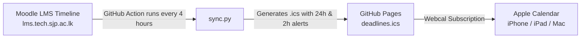

# 📅 LMS Timeline to Apple Calendar Auto-Sync

Automated bridge between your university Moodle LMS (**Faculty of Technology, University of Sri Jayewardenepura**) and **Apple Calendar** (iPhone, iPad, Mac).

---

## 🚀 How It Works



- **Zero Manual Work:** Automatically fetches deadlines from your LMS Timeline.
- **Smart Alarms:** Embeds Apple Calendar alarms **24 hours** and **2 hours** before every deadline.
- **Direct Links:** Each calendar event includes a direct link back to the assignment submission page.
- **Always in Sync:** Runs free in the cloud via GitHub Actions every 4 hours (and whenever you trigger it manually).

---

## 🛠️ Step 1: Test Locally (Optional)

You can test the scraper right on your computer:

```bash
# In this directory:
pip install -r requirements.txt

# Run with your credentials:
set LMS_USERNAME=your_username
set LMS_PASSWORD=your_password
python sync.py
```

This will create `dist/deadlines.ics`. You can open this file in any calendar app to verify your deadlines.

---

## ☁️ Step 2: Set up Free GitHub Cloud Automation

### 1. Create a Repository on GitHub
1. Go to [GitHub.com](https://github.com/new) and create a new repository (e.g., `lms-calendar`).
2. Make it **Public** (required for free GitHub Pages hosting).
   > 🔒 **Security Note:** Your LMS username and password are saved as **Encrypted Secrets**, so they will **NEVER** be visible to anyone or committed to the repository.

### 2. Push this project to GitHub
In terminal / command prompt:
```bash
git init
git add .
git commit -m "Initial commit for LMS Calendar Sync"
git branch -M main
git remote add origin https://github.com/<YOUR_GITHUB_USERNAME>/<YOUR_REPO_NAME>.git
git push -u origin main
```

### 3. Add Your LMS Credentials to GitHub Secrets
1. In your GitHub repository, click **Settings** (top tab).
2. In the left sidebar, expand **Secrets and variables** -> click **Actions**.
3. Click **New repository secret**:
   - Name: `LMS_USERNAME`
   - Value: `<your LMS student id / username>`
4. Click **New repository secret** again:
   - Name: `LMS_PASSWORD`
   - Value: `<your LMS password>`

### 4. Enable GitHub Pages
1. Go to **Actions** tab in your repository and click **Run workflow** on the `Auto-Sync LMS Deadlines to Apple Calendar` workflow. Wait ~30 seconds for it to finish.
2. Go to **Settings** -> **Pages** (in the left sidebar).
3. Under **Branch**, select `gh-pages` and folder `/ (root)`, then click **Save**.
4. GitHub Pages will display your public URL:
   `https://<YOUR_GITHUB_USERNAME>.github.io/<YOUR_REPO_NAME>/deadlines.ics`

---

## 📱 Step 3: Subscribe in Apple Calendar

### On iPhone / iPad
1. Open **Settings** -> scroll down and tap **Calendar**.
2. Tap **Accounts** -> **Add Account**.
3. Choose **Other** -> tap **Add Subscribed Calendar**.
4. In the **Server** box, enter your feed link (replace `https://` with `webcal://`):
   ```
   webcal://<YOUR_GITHUB_USERNAME>.github.io/<YOUR_REPO_NAME>/deadlines.ics
   ```
5. Tap **Next**, customize the calendar name (e.g. `LMS Deadlines`), and enable **Auto-Refresh**. Tap **Save**.

### On Mac
1. Open the **Calendar** app.
2. In the top menu bar, click **File** -> **New Calendar Subscription...**.
3. Paste:
   ```
   https://<YOUR_GITHUB_USERNAME>.github.io/<YOUR_REPO_NAME>/deadlines.ics
   ```
4. Click **Subscribe**.
5. Set:
   - **Auto-refresh**: `Every hour`
   - **Location**: `iCloud` (so it automatically syncs across your iPhone, iPad, and Apple Watch!).
6. Click **OK**.

---

## ⚙️ Configuration & Features

- **Frequency:** By default, GitHub Actions runs every 4 hours (`cron: '0 */4 * * *'`). You can edit `.github/workflows/sync.yml` to change the interval.
- **Timezone:** Defaults to `Asia/Colombo` (+05:30) for University of Sri Jayewardenepura.
- **Notifications:** Built-in alerts trigger 1 day and 2 hours before submission closes.
